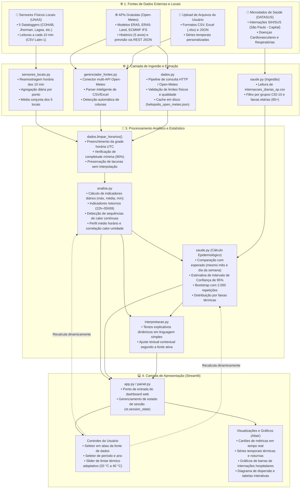

# PAE Heliópolis — Análise Exploratória de Exposição ao Calor Urbano e Saúde

Projeto de extensão universitária voltado à análise de ilhas de calor, extremos térmicos e indicadores de saúde pública na comunidade de Heliópolis (São Paulo / SP), desenvolvido em parceria com a **UNAS (União de Núcleos, Associações dos Moradores de Heliópolis e Região)**.

## 🏛️ Arquitetura do Sistema



---

## 👥 Integrantes e Informações da Entrega

- **Integrantes:**
  - Arthur Silva Correia — RA: 23.00877-6
  - Enzo Grando — RA: 23.00209-3
  - Gustavo Widonsck — RA: 23.00438-0
  - Lucas Silva — RA: 23.00140-2
  - Pedro Kuba Bloise — RA: 23.00161-5
  - Vinicius Takashi Nakatsui — RA: 23.01037-0
- **Vídeo de Demonstração e Apresentação:** [Link youtube](https://youtu.be/J_YbyN_MpMY)
- **Repositório GitHub:** [https://github.com/enzogrando/PAE-Heliopolis](https://github.com/enzogrando/PAE-Heliopolis)
- **Pacote para Windows (Releases):** [Baixar heliopolis_app.zip (versão mais recente)](https://github.com/enzogrando/PAE-Heliopolis/releases/latest/download/heliopolis_app.zip) · [ver todas as versões](https://github.com/enzogrando/PAE-Heliopolis/releases)

---

## 📦 Como Usar o Pacote para Windows (Para o Pessoal da UNAS — Sem Instalar Python)

O sistema foi empacotado para rodar no Windows sem instalar o Python e sem usar o terminal. O pacote é uma pasta compactada (`heliopolis_app.zip`) que já traz o Python dentro dela e um arquivo `iniciar.bat` que abre o painel.

1. Baixe o pacote: **[heliopolis_app.zip (versão mais recente)](https://github.com/enzogrando/PAE-Heliopolis/releases/latest/download/heliopolis_app.zip)** (cerca de 105 MB). Ele também está na aba de **[Releases](https://github.com/enzogrando/PAE-Heliopolis/releases)**.
2. Clique com o botão direito no arquivo e escolha **Extrair tudo**. Não rode o programa de dentro do zip.
3. Abra a pasta extraída e dê um duplo clique em **`iniciar.bat`**.
4. O pacote já traz as bibliotecas necessárias, então **não precisa de internet** para abrir o painel.
5. O painel abre no navegador, no endereço `http://localhost:8501`. Para encerrar, feche a janela preta ou use `Ctrl + C` nela.

> O Windows pode mostrar o aviso "O Windows protegeu o computador" por ser um programa novo. Clique em **Mais informações** e depois em **Executar assim mesmo**.

---

## 🤝 Parceria com a UNAS e Aplicação dos Feedbacks

Este projeto foi construído a partir das visitas presenciais à comunidade e das reuniões de alinhamento com lideranças e equipes da **UNAS**. O feedback recebido direcionou melhorias substanciais no projeto:

1. **Linguagem Acessível e Interface Autoexplicativa:**
   - Adaptação dos textos do painel para que pessoas sem formação técnica em dados ou meteorologia consigam compreender claramente cada métrica e indicador.
   - Inclusão de um **Glossário Completo** e caixas explicativas em cada seção (*"Como ler este gráfico"* e *"O que significam esses números"*).
2. **Transparência e Limites dos Dados:**
   - Deixar explícito que os dados meteorológicos são estimativas regionais de reanálise atmosférica (ERA5, grade de cerca de 25 km, fonte padrão) e não medições de termômetros locais ou de dentro das moradias.
   - Quando o painel usa os sensores locais da UNAS, os textos avisam que são medições reais, mas de poucos pontos e de um período curto (fev–set/2025).
   - Esclarecer que os dados de internação representam a totalidade do município de São Paulo (SIH/SUS) como parâmetro macro, e não exclusivamente os postos de saúde de Heliópolis.
3. **Foco em Grupos Vulneráveis:**
   - Criação de filtros etários direcionados (com destaque para a população idosa de **65 anos ou mais**) e recorte das doenças mais impactadas pelo estresse térmico (doenças cardiovasculares e respiratórias).

---

## 🚀 Funcionalidades Principais

- **Painel Interativo com Streamlit:** Visualização fluida com gráficos interativos em Altair e indicadores sumarizados em cartões.
- **Fontes de dados selecionáveis:** ERA5 (padrão), ERA5-Land, ECMWF IFS e previsão recente (Open-Meteo), média dos 5 sensores locais da UNAS ou upload de arquivo próprio (CSV, Excel ou JSON).
- **Métricas de Calor:**
  - Limiar térmico de calor ajustável pelo usuário (de 20 °C a 40 °C).
  - Identificação de dias quentes e noites quentes (período noturno das 22h às 05h59).
  - Detecção de sequências/ondas de calor contínuas (mínimo de 3 dias consecutivos acima do limiar).
  - Perfil horário médio ao longo das 24 horas e correlação entre temperatura e umidade relativa.
- **Relação Calor e Saúde Pública (SIH/SUS):**
  - Análise descritiva de internações por **Doenças do coração e circulação** (CID-10 I00–I99) e **Doenças respiratórias** (CID-10 J00–J99).
  - Comparação com o volume esperado (média de dias não quentes do mesmo mês e dia da semana, e do mesmo ano quando a série cobre vários anos).
  - Estimativa de intervalo de confiança de 95% via **Bootstrap (2.000 iterações)**.
  - Distribuição das internações por faixas de temperatura máxima (<20 °C, 20–24 °C, 24–27 °C, 27–30 °C, ≥30 °C).
- **Controle de Qualidade dos Dados:**
  - Regra de completude de pelo menos **90% de cobertura horária válida** por período.
  - Preservação estrita de lacunas sem interpolações artificiais.
  - Cache local para garantia de operação mesmo com oscilações de internet.
- **Modo Terminal / CLI:** Script autônomo para exportação em lote de tabelas CSV, parâmetros JSON e relatório descritivo consolidado.

---

## 🏗️ Estrutura e Módulos do Repositório

O projeto possui código modular, limpo e amplamente documentado por meio de docstrings e comentários:

```
PAE-Heliopolis/
├── app.py                  # Ponto de partida do dashboard Streamlit
├── painel.py               # Camada de apresentação e interface com usuário (Streamlit/Altair)
├── analise.py              # Cálculos matemáticos, agregações estatísticas e indicadores térmicos
├── dados.py                # Pipeline de ETL, validação de integridade e consulta ao Open-Meteo
├── sensores_locais.py      # Ingestão dos dataloggers UNAS e média diária dos 5 locais
├── gerenciador_fontes.py   # Seletor multi-API Open-Meteo e parser de upload (CSV/Excel/JSON)
├── saude.py                # Processamento das internações hospitalares e cálculo de bootstrap
├── interpretacao.py        # Textos explicativos dinâmicos e glossário de termos
├── arquitetura_projeto.py  # Especificações de requisitos e arquitetura textual
├── gerar_relatorio.py      # Script de execução em linha de comando (CLI)
├── apoio.py                # Funções utilitárias de suporte e formatação
│
├── assets/                 # Diagramas de arquitetura e imagens de apoio
├── dados_saude/            # Base de dados agregada do SIH/SUS e pasta locaisproximos/ (UNAS)
├── dados_locais/           # Séries temporais em cache e arquivos gerados pelo CLI
├── iniciar.bat             # Abre o painel no Windows (usado no pacote da UNAS)
├── montar_pacote.ps1       # Monta o pacote heliopolis_app.zip com Python embutido
├── requirements.txt        # Bibliotecas Python necessárias
├── exploracao_saude/       # Scripts auxiliares para processamento dos microdados do DATASUS
├── documentacao/           # Relatórios técnicos, fluxogramas e comprovações
└── tests/                  # Testes automatizados unitários
```

---

## 🛠️ Tecnologias e Bibliotecas

- **Linguagem:** Python 3.10 ou mais novo (o pacote para Windows usa o 3.12)
- **Interface e Visualização:** [Streamlit](https://streamlit.io/) e [Altair](https://altair-viz.github.io/) / Vega-Lite
- **Processamento de Dados:** [Pandas](https://pandas.pydata.org/) e [NumPy](https://numpy.org/)
- **Fontes de Dados:**
  - **Open-Meteo Historical Weather API** (Reanálise Copernicus ERA5 / ERA5-Land)
  - **DATASUS / SIH-SUS** (Sistema de Informações Hospitalares do SUS)

---

## 💻 Como Executar para Desenvolvedores e Avaliadores

Se você deseja executar o projeto a partir do código-fonte:

### 1. Clonar o repositório
```bash
git clone https://github.com/enzogrando/PAE-Heliopolis.git
cd PAE-Heliopolis
```

### 2. Configurar o ambiente virtual
```bash
# Windows (PowerShell)
python -m venv .venv
.venv\Scripts\Activate.ps1

# Linux / macOS
python3 -m venv .venv
source .venv/bin/activate
```

### 3. Instalar as dependências
```bash
pip install -r requirements.txt
```

### 4. Executar o Dashboard
```bash
python -m streamlit run app.py
```
No Windows, se `python` não for reconhecido, use `py -m streamlit run app.py`. O Streamlit abrirá uma janela no navegador pelo endereço `http://localhost:8501`.

### 5. Executar via Terminal (CLI)
Para gerar as tabelas em CSV e o relatório textual sem abrir a interface web:
```bash
python gerar_relatorio.py --inicio 2021-01-01 --fim 2025-12-31
```
Os arquivos gerados serão salvos na pasta `dados_locais/`.

---

## 🧪 Testes Automatizados

O repositório inclui testes unitários que cobrem regras de negócio, integridade das funções analíticas e consistência das saídas de saúde:

```bash
# Executar via unittest nativo:
python -m unittest discover -s tests

# Ou via pytest (se instalado):
pytest tests/
```

---

## 📋 Mapeamento de Requisitos da Aplicação

- **Requisitos Funcionais (RF):**
  - **RF01:** Ingestão de dados meteorológicos via JSON local ou requisição à API Open-Meteo.
  - **RF02:** Validação de grade horária, fuso de São Paulo e preservação explícita de lacunas.
  - **RF03:** Filtro por ano no período disponível (2021–2025 no ERA5) e parametrização do limiar de calor de 20 °C a 40 °C.
  - **RF04:** Métricas de frequência, intensidade, noites tropicais e sequências de calor.
  - **RF05:** Comparação descritiva de internações com intervalo de confiança de 95%.
  - **RF06:** Interface amigável, cartões de síntese e suporte a relatório via CLI.

- **Requisitos Não Funcionais (RNF):**
  - **RNF01 (Qualidade Metodológica):** Cobertura horária mínima de 90% para validação de dias e noites.
  - **RNF02 (Rastreabilidade):** Registro de proveniência de dados, parâmetros e metadados de consulta.
  - **RNF03 (Eficiência):** Reutilização de conexões e cache para navegação ágil.
  - **RNF04 (Resiliência):** Tratamento claro de falhas e ausência de rede.
  - **RNF05 (Manutenibilidade):** Separação estrita em módulos e código amplamente documentado.
  - **RNF06 (Acessibilidade Comunitária):** Interface autoexplicativa com distinção explícita entre escopo macro e microterritorial.

---

## 📄 Licença e Uso

Trabalho acadêmico e de extensão comunitária voltado ao planejamento em saúde, meio ambiente e apoio às iniciativas sociais em Heliópolis. Para consultas metodológicas aprofundadas, consulte a pasta [`documentacao/`](documentacao/).
